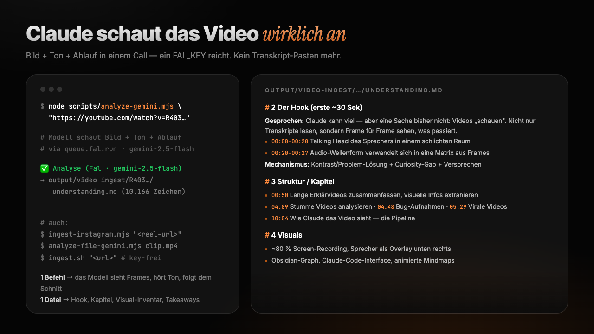

# video-ingest



*Claude kann Texte schreiben, Code bauen und das Web durchsuchen. Aber Videos konnte es lange nicht wirklich anschauen, und genau da steckt bei Video-Content die eigentliche Information: im Bild, im Schnitt, im On-Screen-Text. Dieses Skill gibt Claude Augen für Videos. Ich nutze es täglich, um virale Videos zu zerlegen, Hooks zu verstehen und Skript-Anatomien zu minen. Simon Schaefer, Juli 2026*

Die Idee: Statt Frames zu samplen und einzeln an Claude zu füttern, schickt dieses Skill das **ganze Video nativ an ein video-fähiges Gemini-Modell** über [Fals](https://fal.ai) OpenRouter-Router. Das Modell sieht die Frames, hört den Ton und folgt dem zeitlichen Ablauf in einem einzigen Call. Zurück kommt eine strukturierte Text-Analyse (`understanding.md`), mit der Claude dann arbeitet. Ein FAL_KEY reicht für alles, ein Video kostet wenige Cent. Instagram-Reels und lokale Dateien (Screen-Recordings, stumme Videos) gehen über einen zweiten Weg, und ein komplett key-freier Fallback existiert auch.

## How it works

Es gibt drei Wege, alle liegen in `scripts/`:

- **`analyze-gemini.mjs`** (Weg B, Default): YouTube-URL rein, `understanding.md` raus. Sechs Sektionen: Thema, Hook-Analyse, Kapitel mit Timestamps, Visual-Inventar, Thumbnail-Hebel, Takeaways.
- **`ingest-instagram.mjs`** (Weg C): Instagram-Reel oder lokale Videodatei. yt-dlp lädt, die Datei wird in deinen Storage-Bucket gespiegelt, zurück kommt eine strukturierte Script-Anatomie als `record.json` (Hook wortwörtlich, Beats, CTA, Pacing) plus lesbares `understanding.md`. `mine-reels.mjs` macht daraus einen Bulk-Lauf über eine ganze CSV.
- **`ingest.sh`** (Weg A, key-frei): Untertitel-Transkript plus Scene-Detection-Keyframes, deren Analyse ein Vision-Subagent übernimmt. Der Fallback, wenn kein Key da ist.

Die **`SKILL.md`** macht das Ganze zum Claude-Code-Skill: Claude triggert automatisch, sobald eine Video-URL im Chat auftaucht.

## Quick start

**Voraussetzungen:** Node 18+, ein [Fal-API-Key](https://fal.ai/dashboard/keys). Für Weg A/C zusätzlich `yt-dlp` + `ffmpeg`.

```bash
# 1. Als Claude-Code-Skill installieren (global, gilt in allen Projekten)
git clone https://github.com/simon-schaeferai/video-ingest ~/.claude/skills/video-ingest

# 2. Key hinterlegen
cd ~/.claude/skills/video-ingest && cp .env.example .env
# FAL_KEY in .env eintragen

# 3. Erster Lauf (schreibt ./output/video-ingest/<id>/understanding.md)
node scripts/analyze-gemini.mjs "https://www.youtube.com/watch?v=<id>"
```

Wenn `✅ Analyse … understanding.md` erscheint, bist du startklar. Details und Weg-C-Setup stehen in [SETUP.md](SETUP.md).

## Using it

Danach reicht in Claude Code ein normaler Satz mit einer Video-URL:

```
Schau dir dieses Video an und sag mir, warum der Hook funktioniert:
https://www.youtube.com/watch?v=...
```

Claude ingestet das Video selbst und antwortet auf Basis von Bild, Ton und Ablauf.

## Design choices

- **Natives Video-Verständnis statt Frame-Sampling.** Frame-Batches sehen keine Bewegung zwischen den Bildern, kein echtes Schnitttempo und keine Betonung in der Stimme. Der Nachteil: Weg B funktioniert nur mit öffentlichen YouTube-URLs, alles andere braucht Weg C.
- **Fal-Router statt direktem Google-Key.** Ein Key für alles, stabile Abrechnung, und das Modell bleibt per `FAL_VIDEO_MODEL` austauschbar. Der Nachteil: Der Output ist auf 8k Tokens begrenzt, sehr lange Videos liefern gekürzte Verbatim-Transkripte.
- **Text-Dateien als Schnittstelle.** Claude liest nie Frames im Hauptkontext (ein Bild kostet 1.000 bis 1.500 Tokens), sondern immer nur den Text-Output. Dadurch bleibt der Kontext auch bei Bulk-Läufen über hunderte Videos schlank.
- **Idempotent und ehrlich.** Vorhandene Records werden übersprungen, gescheiterte Downloads (Login-Wall, gelöscht) landen in einem Failure-Log statt still zu verschwinden.

## Limitations

Weg B kann nur öffentliche YouTube-URLs, private oder Plattform-fremde Videos laufen über Weg C. Sehr lange Videos können am 6-Minuten-Timeout des Fal-Routers scheitern. Weg C spiegelt die Datei in deinen eigenen Supabase-Bucket (öffentliche URL), das Aufräumen liegt bei dir. Die Analyse-Prompts sind auf Deutsch gebaut, Transkripte bleiben aber immer in der Originalsprache des Videos.

## License

MIT
